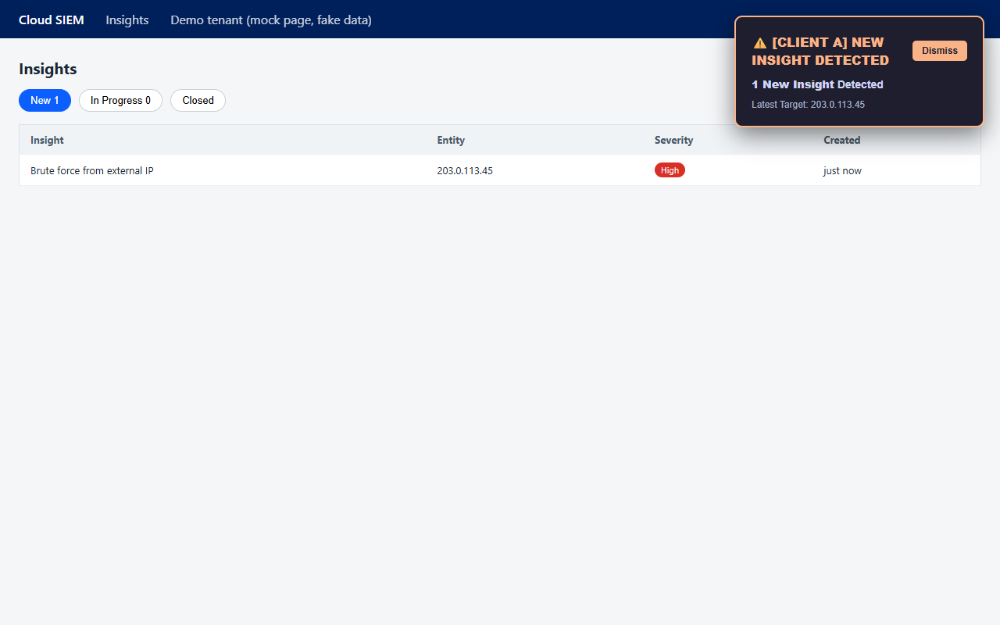
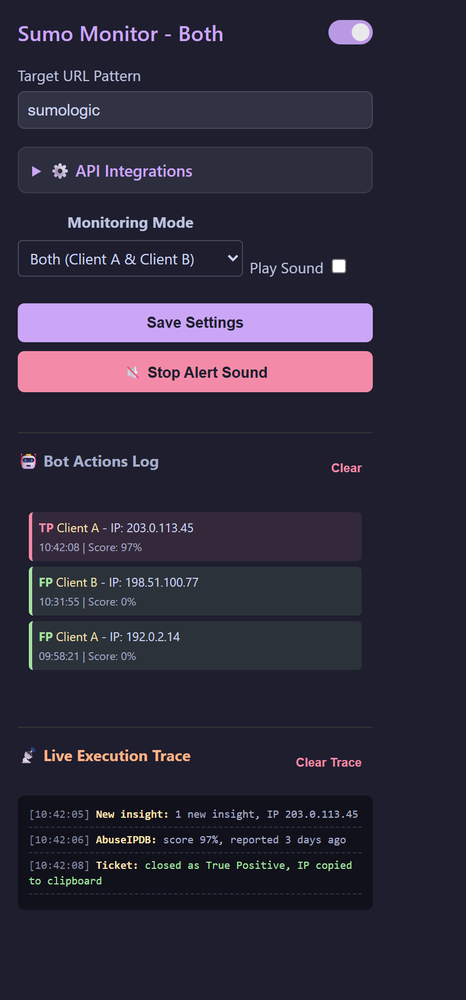

# Sumo Logic SIEM Monitor

A Chrome extension I built during my internship in a security operations team. The SOC kept a Sumo Logic Cloud SIEM tab open all day, waiting for new insights. I made this so a tab in the background could do the waiting and shout when something needed a human.

> Showcase repo: notes and screenshots only. The screenshots use a mock page, documentation-range IP addresses and generic client names ("Client A", "Client B"). No real tickets or customer data.

## What it does

- **Watches the insights page** and plays a repeating sound plus a notification when the **New** counter goes up.
- **Checks the IP for you** with AbuseIPDB (and hashes or domains with VirusTotal) and shows a small card with the score, ISP and last report.
- **Highlight to check.** Select any IP on the page to look it up by hand.
- **Closes obvious tickets on its own.** A recently reported IP is closed as a True Positive and copied to the clipboard so it can be blocked. A clean or very old one is closed as a False Positive with a comment that explains why. If the lookup fails, it moves the ticket to In Progress and alerts a human instead of guessing.
- **Knows what it can't handle.** Tickets that are not about an IP get a "manual review" alert.
- **Popup with a bot log.** Settings, a log of everything the bot closed, and a live trace of what it is doing right now.

## Built with

- Chrome extension (Manifest V3), service worker, scripts injected into the page
- Plain JavaScript, no frameworks
- AbuseIPDB and VirusTotal APIs

## What I learned

- Manifest V3 service workers go to sleep, so the extension needs a heartbeat alarm and an offscreen page to keep playing sound.
- Automating someone else's web app means waiting for the page to be ready instead of trusting fixed delays.
- Text that comes from a page or from a threat-intel report is untrusted. I went back later and escaped it before it goes into the overlays, and cut the extension's access down to the three sites it needs.
- A clean reputation score is not proof an IP is safe, so the bot hands anything unclear to a human.

Made by **KH4I**
